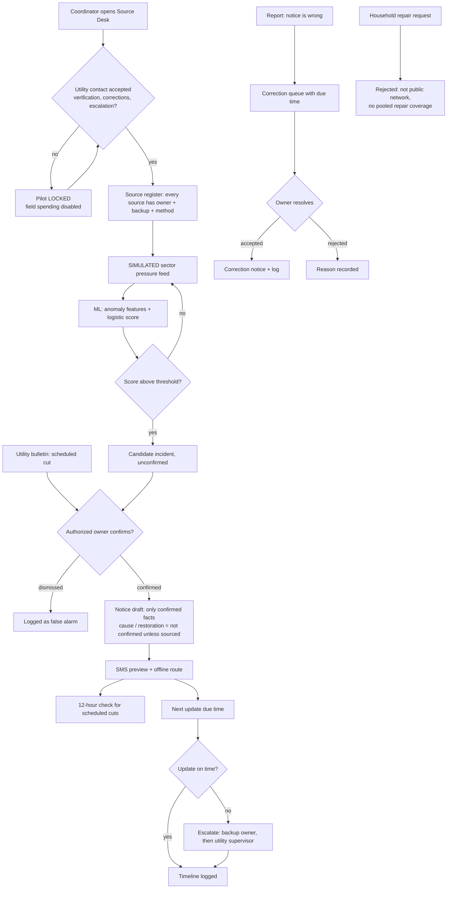
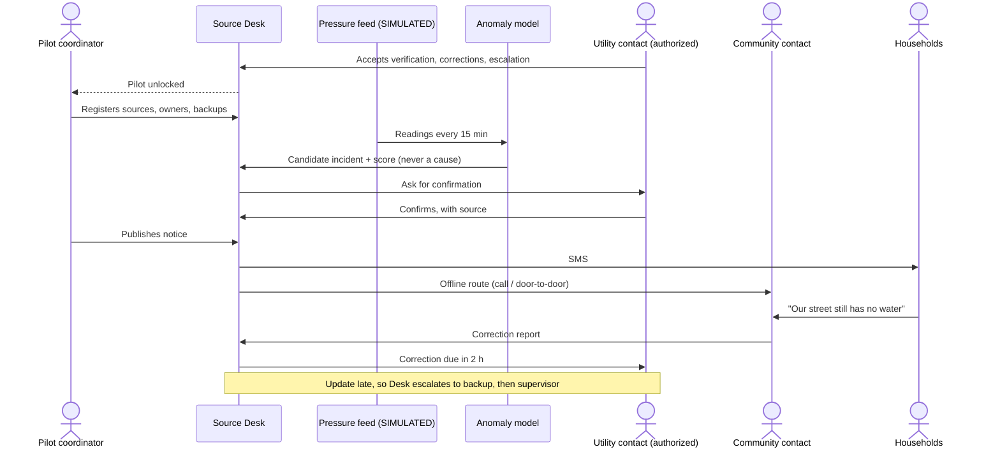

# PACKET — Source Desk (Week 11 · Business Bending)

**Builder:** Asael González (Team 7 · Operator this week)
**Blueprint:** Team 7 "Agua a Tiempo MX", Week 11. Primary vacuum: **Household water tools**: a private reserve ledger connected to verified supply-incident notices and accountable follow-up.
**My declaration:** onboarding, source-owner register, correction queue and escalation log. It honors Conditions **3** (operational authority) and **4** (timeliness and access).

---

## 1. Problem, in my words

A notice that says "your water will be cut tomorrow" is only useful if someone answers for it. Today, in a sector under *tandeo*, nobody can say who confirmed a cut, where the information came from, who fixes it when it's wrong, or who gets called when the promised update never arrives. A pressure logger can show that something dropped, but it can't tell a family whether to fill the *tinaco* tonight.

The team chose a household tool. My part is the operating layer behind it. Before a single SMS goes out, every source of information needs a named owner and a backup. Every official event must be confirmed by an authorized person. Every wrong notice goes into a correction queue with a deadline. And every missed update escalates to someone with a name. If a utility contact hasn't accepted those duties, the pilot stays locked and no money is spent in the field.

## 2. Exact user

**The pilot coordinator** of Agua a Tiempo MX: one person who runs the 100-household, three-month pilot day to day. They are not an engineer and not a utility employee. They work with one **utility contact** (an operations desk at the water utility), one or two **community contacts** who carry the offline route, and the households, who only receive SMS or a call. The coordinator opens Source Desk every morning and whenever the feed flags something.

## 3. Success definition

> Before the module closes, at a live URL, a pilot coordinator can: (1) see the pilot **locked** until a utility contact accepts source verification, corrections and escalation, with field spending disabled; (2) register every information source with an owner, a backup and a verification method; (3) watch a **SIMULATED** sector pressure feed where an ML model flags **candidate** incidents, which only an authorized person can confirm; (4) publish a confirmed notice with an SMS preview that never invents a cause, restoration time or quality claim, and see whether a scheduled cut met the **12-hour** target; (5) work a **correction queue** with due times; and (6) see the **escalation log** fill automatically when an update is late, with every timestamp the Blueprint asks for.

## 4. Mockup (image-generated)

`docs/mockup.png`, generated with Gemini (Canvas) from this prompt:

> *Desktop web dashboard, calm and serious, white cards on a light gray background, deep teal accents. Title "Source Desk — Agua a Tiempo MX pilot". A red banner at the top: "Pilot LOCKED: utility contact has not accepted corrections and escalation. Field spending disabled." Left column: a map of four numbered water sectors as colored circles (no houses, sector level only). Right column: a small line chart labeled "Sector pressure (SIMULATED feed)" with a dip highlighted and a card "Candidate incident: Sector 2, model score 0.91, awaiting authorized confirmation". Below: three tabs "Correction queue", "Escalation log", "Source register", with a table of rows showing owner, due time and status chips (on time / late / escalated). An SMS preview bubble: "Agua a Tiempo: Corte programado Sector 2, jue 06:00. Confirmado por: Mesa de Operación. Causa: no confirmada." No ads, no household map.*

## 5. The flow (Mermaid)

### Flowchart

### Swimlane: who does what

## 6. Benchmark line

- **The best existing solution on Earth for this is** Singapore PUB's water-operations model (smart meters and network sensors feeding a utility control room with defined incident ownership and customer notices), together with WINT, which detects anomalies in water use and routes them to a named responder.
- **Mine differs or localizes by** starting with no new hardware and no utility IT integration: a coordinator-run desk that makes **human accountability** the gate (named owner, backup, deadline, escalation) for sectors under *tandeo*, where the failure isn't missing data but the fact that no one answers for the notice.

## 7. The long view (3 years)

If this slice works, Source Desk becomes the accountability layer between Mexican water utilities and the people they ration: a shared register of who confirms what, a public scorecard of notices delivered on time, and a correction record that turns complaints into evidence. With that record, a utility can justify real meters where the misses cluster, and a city can compare utilities by how fast they answer. It stays free for households, because the people who pay for the failure should not pay for the notice.

## 8. Scope cut (what I am NOT building)

- No household reserve ledger or preparation test (Regina's declaration).
- No SMS sending, notice review page or cost scorecard beyond a simple counter (Valeria's). The SMS is a **preview**; nothing is sent.
- No stress-test suite (Inés's).
- No real sensor hardware, no utility system integration, no real personal data. The feed is **SIMULATED** and labeled on screen.
- No household map. The map shows **sectors only** (Condition 5).
- No repair marketplace or pooled coverage (Condition 3).
- No AI prediction of cause, restoration time or water quality (Condition 2).
- No database or accounts: pilot data lives in the browser, with invented names and a reset button.

## 9. Architecture + stack

| Layer | Choice | Why |
|---|---|---|
| Framework | Next.js 15 (App Router, TypeScript) | Same stack as my previous ships |
| Hosting | Vercel (free) | Auto-deploy on every push |
| **IoT / sensing** | Seeded **SIMULATED** sector pressure feed (`lib/feed.ts`), 15-minute readings with a daily pattern, noise and injected events | Course allows labeled simulated feeds; the Blueprint says "manual readings before hardware" |
| **ML** | Logistic regression trained in the browser on SIMULATED labeled history (`lib/ml.ts`), using drop size, z-score, persistence and neighbor drop. Held-out accuracy shown on screen | Separates real supply drops from sensor glitches; outputs a **candidate** only |
| **Geodata** | Leaflet + OpenStreetMap tiles, four fictional pilot sectors as circles | Sector level only; no households |
| Logic | Deterministic rules (`lib/rules.ts`): launch gate, 12-hour check, SMS builder, escalation, validation | Testable and explainable |
| Storage | localStorage, invented data only, "Reset demo" button | No personal data on a server, so no auth needed (security floor #2) |
| Secrets | None needed | Security floor #1 |

**Dragon Stack:** IoT/sensing (SIMULATED feed) + ML (anomaly classifier) + geodata (sector map).

## 10. Test plan

| # | Test | Expected |
|---|---|---|
| T1 | Load the app fresh | Red "Pilot LOCKED" banner; "Authorize field spending" disabled |
| T2 | Accept only 2 of 3 utility duties | Still locked; banner names the missing duty |
| T3 | Accept all 3 + every source has a backup | Unlocked; spending button enabled |
| T4 | Advance simulated clock past the injected drop in Sector 2 | Candidate incident appears with score, marked "awaiting confirmation" |
| T5 | Sector 3 one-reading glitch | Score below threshold, or dismissed and logged as a false alarm |
| T6 | Confirm with an owner who isn't authorized | Blocked with a message |
| T7 | Publish notice without a sourced cause | SMS says "Causa: no confirmada"; no restoration time |
| T8 | Scheduled cut entered 8 h ahead | Marked "below 12-hour target"; scorecard denominator increases |
| T9 | Let "next update" pass without an update | Escalation log adds backup, then supervisor |
| T10 | Add a correction, resolve it | Correction notice logged with times |
| T11 | Submit a household repair request | Rejected with Condition 3 message |
| T12 | Forms with empty or 500-character input | Validation messages, nothing saved |
| Unit | `npm test` | Gate, 12-hour rule, SMS builder, escalation and model checks pass |

Persona test after deploy: a synthetic pilot coordinator walks the screens and narrates where she hesitates; worst confusion fixed and redeployed.
